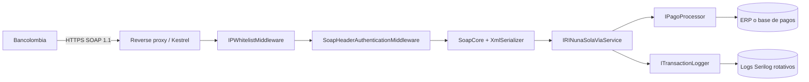
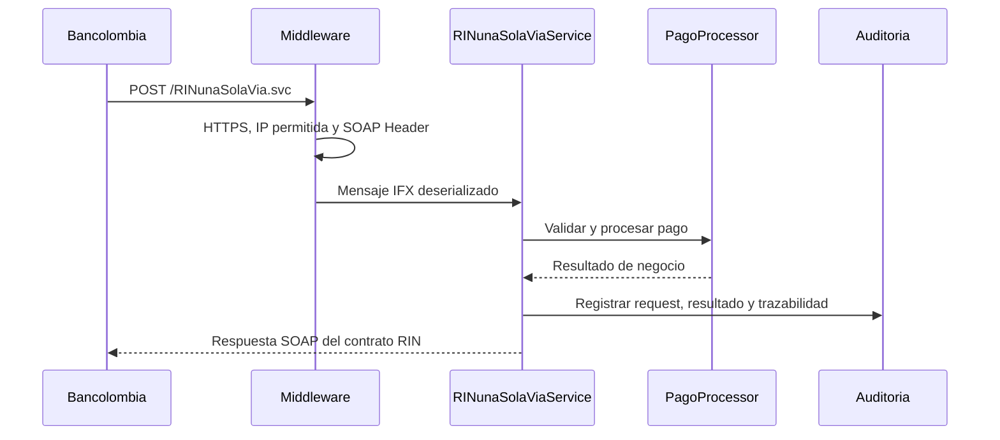
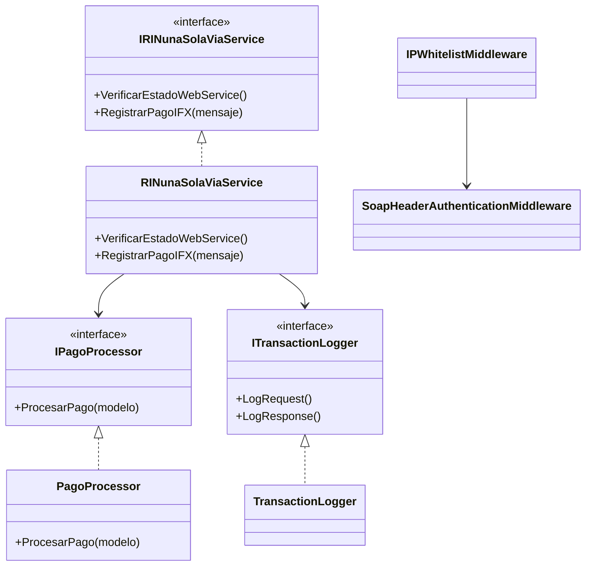

# Bancolombia WebService - RIN Una Sola Vía

Servicio SOAP en .NET 8 para recibir notificaciones de pagos de Bancolombia mediante el contrato **Recaudo Integrado al Negocio (RIN)**. El proyecto implementa el endpoint operativo, los contratos IFX, autenticación en el encabezado SOAP, lista de IP permitidas y auditoría estructurada.

## Objetivo y alcance

El servicio atiende dos operaciones del flujo RIN:

- `VerificarEstadoWebService`: comprobación de disponibilidad.
- `RegistrarPagoIFX`: recepción y validación de pagos en formato IFX dentro de SOAP/CDATA.

El snapshot contiene la solución, contratos, seguridad, servicio y scripts de prueba. La conexión definitiva con la base de datos o ERP se mantiene detrás de `IPagoProcessor`, para no acoplar el contrato Bancolombia con una implementación de persistencia.

## Arquitectura



### Secuencia de una notificación



## UML de componentes y clases



## Decisiones arquitectónicas

| Decisión | Motivo | Consecuencia |
|---|---|---|
| SOAP con `SoapCore` y `XmlSerializer` | El contrato RIN usa `MessageContract` y XML interoperable | El WSDL queda disponible en `/RINunaSolaVia.svc?wsdl`. |
| IP whitelist antes de autenticación | Reduce superficie de exposición y sigue el control de red del proveedor | Las IP autorizadas deben configurarse por ambiente. |
| Autenticación en SOAP Header | Respeta el formato de seguridad requerido por Bancolombia | Las credenciales nunca deben quedar en el código. |
| `IPagoProcessor` como puerto de negocio | Permite conectar ERP/BD sin modificar el contrato externo | Se puede probar el servicio con un procesador controlado. |
| Serilog con rotación diaria | Se requiere trazabilidad de transacciones | Los logs se conservan por defecto durante 30 días. |
| HTTPS obligatorio fuera de desarrollo | Protege el transporte de pagos y credenciales | Testing/producción requieren certificado configurado. |

## Ejecución local

```powershell
dotnet restore BancolombiaWebService.sln
dotnet run --project BancolombiaWebService/BancolombiaWebService.csproj
```

Después de iniciar:

- Estado: `https://localhost:<puerto>/`
- WSDL: `https://localhost:<puerto>/RINunaSolaVia.svc?wsdl`
- Pruebas auxiliares: `iniciar-pruebas.ps1`, `test-servicio.ps1` y `setup-testing.ps1`.

## Seguridad y operación

- No subir certificados, claves privadas, tokens ni configuraciones productivas.
- Mantener `appsettings.Production.json` y `appsettings.Testing.json` fuera del control de versiones.
- Configurar IPs permitidas, credenciales SOAP y certificado mediante el ambiente de despliegue.
- Correlacionar cada pago con los logs de auditoría antes de confirmar una conciliación.

## Estado del snapshot

El repositorio conserva la implementación y los contratos existentes. La integración definitiva de `PagoProcessor` con el ERP queda como punto de despliegue/configuración; esta documentación no cambia esa decisión de negocio.
